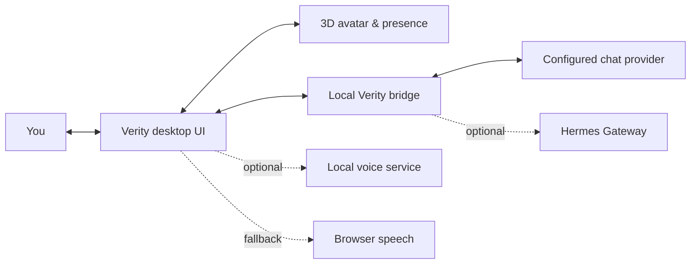

<div align="center">


# VERITY

### A little presence for your desktop.

An expressive 3D companion for AI conversations, voice, and agent activity. Verity brings a living avatar, a hands-on motion studio, and optional Hermes Gateway integration into one desktop app.

<p>
  <a href="#-get-started"><strong>Get started</strong></a> ·
  <a href="#-what-verity-does">Explore features</a> ·
  <a href="docs/HERMES_DESKTOP_CLIENT.md">Hermes integration</a>
</p>


</div>

<br>

> **Verity is a character, a control room, and a desktop presence.** Talk to your configured AI provider, watch the avatar react, shape its behavior in the studio, or let it float beside your work.

<details>
<summary><strong>Contents</strong></summary>

- [What Verity does](#-what-verity-does)
- [A quick tour](#-a-quick-tour)
- [Get started](#-get-started)
- [Connect an AI provider](#-connect-an-ai-provider)
- [Voice and local services](#-voice-and-local-services)
- [Developer commands](#-developer-commands)
- [Project map](#-project-map)
- [Privacy notes](#-privacy-notes)
- [Commercial release](#-commercial-release)

</details>

## ✨ What Verity does

| | | |
|:--|:--|:--|
| **A face with range** | 15 reference expressions and a library of procedural behaviors bring reactions to life. | **A companion that moves** | Keep Verity in the studio or pop it out into a compact floating desktop view. |
| **A voice you can shape** | Optional local speech synthesis, local custom speech, microphone input, and animated lip movement. | **A studio to tune it** | Explore motion, expression, presence, voice, and conversation controls in one interface. |
| **Agent-aware presence** | Optional Hermes Gateway connection can surface agent activity and tool states through the avatar. | **A little theatre** | Trigger playful actions directly from the interface, from a yawn to a screen breakout. |

## 🪩 A quick tour

The gold sphere is Verity’s canvas: a configurable avatar that responds as the conversation moves.

<p align="center">
  
</p>

<details>
<summary><strong>How the pieces fit together</strong></summary>



The desktop UI and avatar run locally. Chat, transcription, and speech services depend on the provider and options you configure. Hermes and local neural voice are optional.

</details>

## 🚀 Get started

### Requirements

- Windows is the primary development target.
- Node.js and npm. Use a Node version compatible with the Electron dependency in `package-lock.json`.
- Optional: Python and model files for local voice and sentiment services.
- Optional: a reachable Hermes Gateway or chat-provider API key for connected conversations.

### Launch the desktop app

```powershell
git clone <your-repository-url>
cd verity_desktop
npm ci
npm start
```

Other launch modes:

```powershell
npm run overlay   # Launch in floating companion mode
npm run studio    # Start the local studio web server
npm run hermes    # Launch the Hermes-enabled companion
```

> `npm run studio` starts the local server at `http://127.0.0.1:4777`. Open that address in a browser while the server is running.

### Optional configuration for the browser server

Create your private `.env` file from the example:

```powershell
Copy-Item .env.example .env
```

Add only the provider settings you plan to use. `.env` is ignored by Git; keep API keys out of source files, screenshots, and commits.

## 🔌 Connect an AI provider

Choose a provider in the conversation bar and use **Setup** to add, replace, or forget its key. In the Windows desktop app, saved API keys are encrypted with the operating system account and stored on this device; requests go directly to the provider you choose. Existing environment provider keys are copied once into encrypted settings if no key is already saved for that provider. Afterward the desktop app uses the saved keys, so forgetting a key removes it from desktop use. The original `.env` file is not changed. Cloud providers may require their own account or billing setup. The browser studio does not save keys; use `.env` there.

Built-in providers include OpenAI, Azure OpenAI, Anthropic Claude, Google Gemini, Groq, OpenRouter, Mistral, DeepSeek, xAI, Together AI, Fireworks AI, Cerebras, Perplexity, Cohere, and SambaNova. Verity also supports local Ollama and LM Studio servers, a custom OpenAI-compatible endpoint, and an optional Hermes Gateway. Use **Load available models** to fetch the list from your selected provider.

Provider environment variables are available for command-line and browser-server setups:

| Variable | Purpose |
|:--|:--|
| `HERMES_GATEWAY_URL` | Base URL of the Gateway API |
| `HERMES_MODEL` | Model name requested from the Gateway |
| `HERMES_SESSION_KEY` | Conversation session identifier |
| `HERMES_API_KEY` | Bearer token when Gateway authentication is enabled |
| `OPENAI_API_KEY`, `AZURE_OPENAI_API_KEY`, `ANTHROPIC_API_KEY`, `GOOGLE_API_KEY` | Keys for the matching cloud providers |
| `GROQ_API_KEY`, `OPENROUTER_API_KEY`, `MISTRAL_API_KEY` | More supported cloud providers |
| `DEEPSEEK_API_KEY`, `XAI_API_KEY`, `TOGETHER_API_KEY` | More supported cloud providers |
| `FIREWORKS_API_KEY`, `CEREBRAS_API_KEY`, `PERPLEXITY_API_KEY` | More supported cloud providers |
| `COHERE_API_KEY`, `SAMBANOVA_API_KEY` | More supported cloud providers |
| `CUSTOM_OPENAI_API_KEY`, `CUSTOM_OPENAI_BASE_URL`, `CUSTOM_OPENAI_MODEL` | Custom OpenAI-compatible API |
| `AZURE_OPENAI_ENDPOINT`, `AZURE_OPENAI_MODEL` | Azure resource endpoint and deployment name |
| `*_MODEL` | Optional default model ID for that provider |

See [docs/HERMES_DESKTOP_CLIENT.md](docs/HERMES_DESKTOP_CLIENT.md) for the Gateway flow and additional configuration notes. Keep the Gateway bound to a trusted local network and supply your own credentials.

## 🎙️ Voice and local services

Voice is optional. The UI can fall back to browser speech if local synthesis is unavailable. The local service commands expect a separately prepared Python environment and the required model files:

```powershell
npm run tts         # Kokoro voice service
npm run tts:qwen    # Qwen voice service
npm run sentiment   # Local sentiment service
```

Microphone transcription currently supports OpenAI and Groq. Chat supports all providers above. Review the selected provider’s data handling before enabling voice input.

## 🧰 Developer commands

| Command | What it does |
|:--|:--|
| `npm start` | Launch the Electron desktop app |
| `npm run overlay` | Launch the compact companion mode |
| `npm run studio` | Run the local studio server |
| `npm run hermes` | Start the Hermes launcher |
| `npm run test:presence` | Check presence rules |
| `npm run test:orb` | Check companion gestures |
| `npm run test:emotion` | Check emotion and motion selection |
| `npm run test:hermes` | Check the Hermes client integration |

Some integration checks need Electron, local services, or configured provider credentials. Run only the checks relevant to your change.

## 🗂️ Project map

```text
src/                       Electron app, UI, local bridge, and assets
services/                  Python voice, sentiment, and memory services
tests/                     Unit and integration checks
scripts/                   Launch and setup scripts
bin/                       Command-line launcher
docs/                      Integration and release notes
```

## 🔒 Privacy notes

- App preferences and conversation history can be stored locally by the app.
- The avatar’s cursor-follow behavior is processed locally; it does not need to transmit cursor coordinates to the chat provider.
- Chat and microphone transcription may send content to the provider you configure.
- Optional local voice services run on loopback ports. Install and configure their model dependencies separately.

Check your provider settings and local environment before sharing logs or diagnostic files.

## 📦 Commercial release

This repository is still in development. No project distribution license is specified yet. Before distributing source or binaries, review [docs/RELEASE_CHECKLIST.md](docs/RELEASE_CHECKLIST.md), confirm rights for code and media, audit dependency notices, and define the installer, signing, privacy, and support processes.

<div align="center">

<sub>Built for a desktop that feels a little less empty.</sub>

</div>
