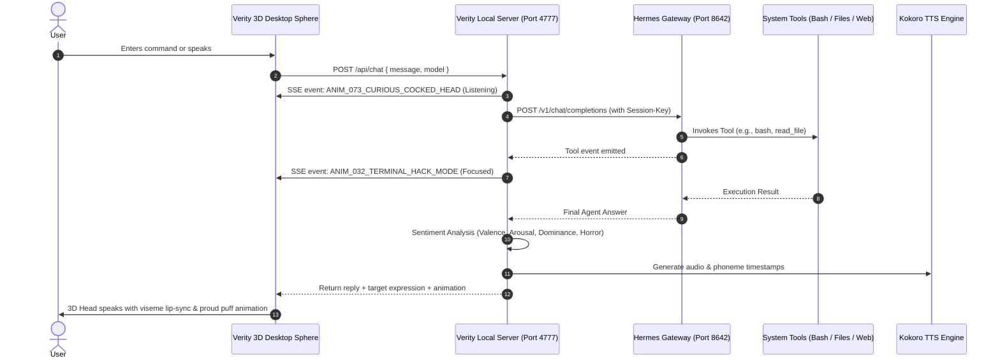

# Verity 3D // Hermes Agent Unified Desktop Client

> **The Embodied Interaction & Visual Presence Layer for Nous Research's Hermes Agent**

---

## 1. Overview

**Hermes Agent** is a platform-agnostic, self-hosted, tool-using AI agent framework developed by Nous Research. It excels at autonomous execution, bash/shell scripting, file modification, web search, dynamic skill synthesis, and long-term memory.

**Verity 3D** is a desktop application featuring an uncanny, faceted golden-yellow 3D head/sphere with **15 iconic reference expressions**, **120 procedural behavioral animations**, **real-time psychological sentiment appraisal**, and **Kokoro voice lip-sync**.

By running Verity as the **Unified Desktop Client** on top of Hermes Agent:
* **Hermes Agent** operates as the central cognitive engine and tool-execution brain (running its Gateway daemon on port `8642`).
* **Verity** serves as the **embodied desktop interaction layer**: floating on top of your windows, reacting in real time to the agent's internal thoughts and tool actions, and speaking replies aloud with procedural lip-sync.

---

## 2. Architecture & Communication Flow



---

## 3. Tool-to-Animation Mapping Matrix

When Hermes Agent calls tools to execute tasks on your machine, Verity automatically detects the tool signature and updates the 3D companion's kinematics:

| Agent Action / Tool Type | Verity Expression | Verity 3D Behavioral Animation | UI Status Pill |
| :--- | :--- | :--- | :--- |
| **Terminal / Bash / Shell** (`bash`, `sh`, `exec_command`) | `1: Unamused` | `ANIM_032_TERMINAL_HACK_MODE` | `⚡ [TOOL: bash]` |
| **Code Inspection / Patching** (`edit_file`, `write_file`) | `12: Suspicious` | `ANIM_023_DEEP_DEBUG_SQUINT` | `⚡ [TOOL: code_patch]` |
| **File Scanning / Discovery** (`read_file`, `grep`, `dir`) | `0: Classic Smile` | `ANIM_024_DATA_SCAN_SWEEP` | `⚡ [TOOL: data_scan]` |
| **Network & Web Retrieval** (`web_search`, `fetch`, `curl`) | `0: Classic Smile` | `ANIM_074_EAGER_LEAN_IN` | `⚡ [TOOL: web_search]` |
| **Memory / Skill Synthesis** (`save_skill`, `recall_memory`) | `8: Parted Grin` | `ANIM_025_EUREKA_EPIPHANY` | `⚡ [TOOL: memory]` |
| **Tool Error / Execution Crash** | `7: Shocked` | `ANIM_044_KERNEL_PANIC_SHAKE` | `⚠️ [TOOL ERROR]` |
| **Task Finished / Final Speech** | Dynamic (via Sentiment) | `ANIM_001_HAPPY_BOUNCE` / `ANIM_005_PROUD_CHEST_PUFF` | `⚡ HERMES AGENT READY` |

---

## 4. One-Click Quickstart (`Verity.exe`)

All background processes (Hermes Gateway detection/start, Kokoro Neural Voice TTS, Electron 3D Sphere, and auto-cleanup on exit) are compressed into a single native executable: **[`Verity.exe`](file:///c:/Users/vaibh/Desktop/projects/verity_dekstop/Verity.exe)**.

### Single Executable Execution
Just double-click **`Verity.exe`** in this folder!

* **Floating 3D Companion Sphere (Default)**:
  ```bash
  .\Verity.exe
  ```
* **Full Studio UI**:
  ```bash
  .\Verity.exe --studio
  ```
* **Custom Gateway URL**:
  ```bash
  .\Verity.exe --gateway http://127.0.0.1:8642/v1
  ```

> **Automated Lifecycle Guarantee:** `Verity.exe` assigns all spawned background processes (Python Kokoro TTS server and Hermes Gateway) to a Windows **Job Object** (`JOB_OBJECT_LIMIT_KILL_ON_JOB_CLOSE`). When you close the 3D Sphere window, all background processes are cleanly terminated with zero orphaned tasks left in Task Manager.

---

## 5. Configuration & Environment Variables

| Variable | Default Value | Description |
| :--- | :--- | :--- |
| `HERMES_GATEWAY_URL` | `http://127.0.0.1:8642/v1` | URL of the Hermes Gateway API |
| `HERMES_MODEL` | `nousresearch/hermes-3-llama-3.1-8b` | Default model alias requested from Hermes |
| `HERMES_SESSION_KEY` | `verity-desktop-session` | Persistent session ID for multi-turn conversational memory |
| `HERMES_API_KEY` | `hermes-local` | Bearer token if Hermes Gateway authentication is enabled |
| `VERITY_PORT` | `4777` | Local HTTP & SSE port for Verity's desktop control bridge |

---

## 6. Voice & TTS Lip-Sync Integration

To enable neural voice speech synthesis alongside Verity's lip-sync:
```bash
# In a separate terminal, launch the local Kokoro TTS engine:
npm run tts
```
When enabled in the Verity UI (`Auto-Voice` checkbox checked), every reply from Hermes Agent is spoken aloud in Verity's custom voice with exact viseme lip deformation.
